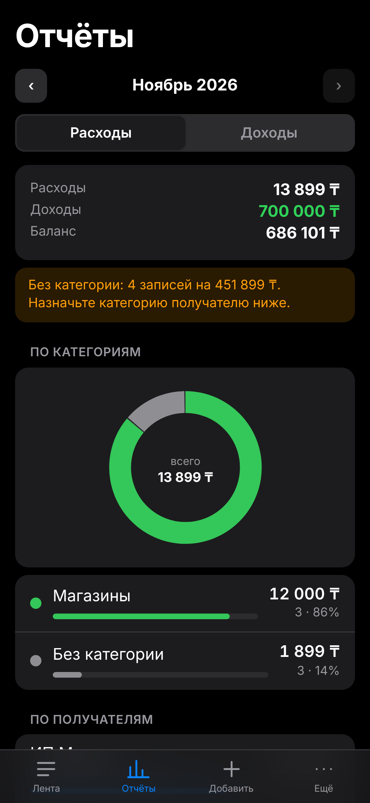
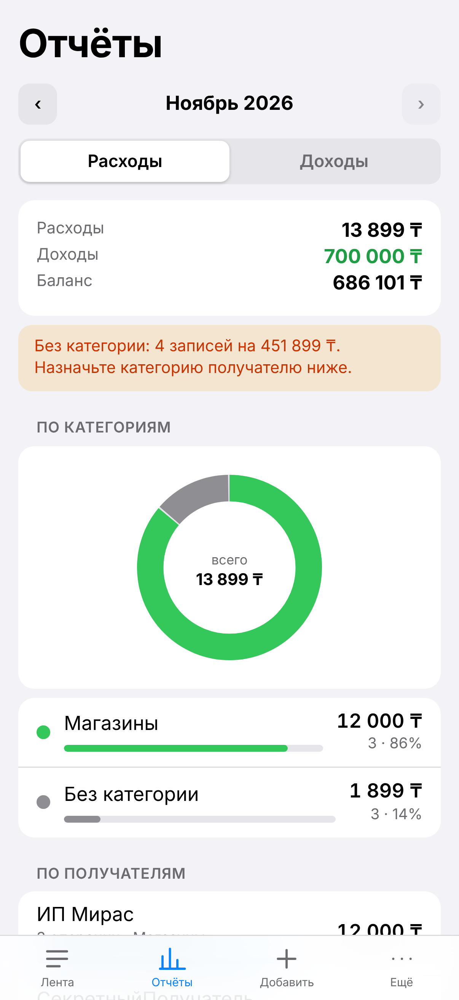
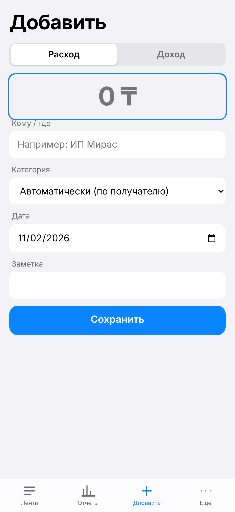

# Personal Finance Tracker (PWA)

iPhone-first progressive web app for tracking personal income and expenses. Import bank statements, assign your own categories to payees, see charts by category and by payee, and log expenses in seconds from **iOS Shortcuts** without opening the app.

Stack: **Cloudflare Workers + D1 (SQLite)**, **React + Vite + TypeScript**. No AI: classification is deterministic and fully user-controlled.

| Reports (dark) | Reports (light) | Add entry |
|---|---|---|
|  |  |  |

## Features

- **Statement import (Kaspi/Halyk/Freedom text PDFs and generic CSV)** with a per-row report: every line is accounted for as *imported*, *duplicate* or *rejected (with reason)*. Re-importing the same file adds nothing; an import can be rolled back as a whole. Column mapping is manual for now (single signed amount, separate debit/credit columns, or a type column).
- **Your own categories.** Create, rename, recolor and delete categories. Assign a payee once (e.g. "Sole proprietor X" → *Groceries*) and the whole history is recategorized. Text rules (e.g. "salary" → *Salary*) for incoming transfers.
- **Charts and lists** per month: by category (donut + bars) and by payee (count and total).
- **Manual entry** with an offline queue (IndexedDB, idempotent IDs, retry with backoff and `Retry-After`, encrypted at logout).
- **iOS Shortcuts API**: scoped API keys (`write` can only add entries, `read` can only fetch a summary), revocable, hashed at rest, rate-limited. Recipes: [docs/SHORTCUTS.ru.md](docs/SHORTCUTS.ru.md) (Russian).
- **Accounts and security**: PBKDF2 password hashing, server-side sessions, device revocation, login lockout, CSP and security headers, strict per-account data isolation (covered by tests), CSV export with formula-injection escaping.
- **Apple-style UI**: OLED-black and light themes, safe-area aware, tab bar, reduced-motion support.

## Status and limitations

Honest list of what is **not** done or **not verified** (details in [docs/STATUS.ru.md](docs/STATUS.ru.md)):

- Not tested on a physical iPhone or in Safari (browser tests run in Chromium with iPhone emulation).
- Published at https://qarjy.tarlan-b06.workers.dev. Destructive crash tests run locally on synthetic data; public smoke tests do not create financial records.
- Bank PDF parsers support only the layouts verified against local samples; OCR and arbitrary bank layouts are unsupported.
- No XLSX/OCR, offline edits or push notifications; single currency (KZT). Opening balances remain dated snapshots, separate from transactions.

## Quick start

```bash
npm install
npm run build
npm test            # server/client tests, real SQLite
npm run test:e2e    # Playwright, iPhone viewport, dark + light
npm run dev         # local server on http://localhost:8787
```

Create a local account: `npm run accounts -- add owner "Owner" --db .wrangler/dev.sqlite` (password is entered hidden). Deployment steps for Cloudflare (D1 creation, migrations, `wrangler deploy`) are in [README.ru.md](README.ru.md).

## Project layout

```
migrations/        D1 schema (core + money domain)
worker/src/        API: auth, sessions, API keys, rate limits
worker/src/domain/money/   entries, categories, payees, import, reports, shortcuts
worker/dev/        D1-compatible SQLite adapter (tests and local dev only)
web/src/           React client (screens, offline queue, theme)
scripts/           admin CLI, dev server, secret scanner, deployment check
tests-e2e/         Playwright tests
docs/              design decisions, status, Shortcuts recipes (Russian)
```

## License

MIT

## Client onboarding and audit

Select an account and enter its password. Only enabled accounts explicitly listed in LOGIN_ACCOUNTS appear in the public picker; other accounts remain unlisted. Manual login remains available as a fallback. Password changes are under More → Settings and require at least 10 characters. A five-step questionnaire collects accounts, opening balances, preferred categories, income plans, obligations and a goal. Add a custom expense category directly during onboarding. Answers are account-scoped and can be edited under More. Use Node 24 LTS (see package.json engines). The crash-test protocol and remaining limits are documented in [docs/CRASH_AUDIT.ru.md](docs/CRASH_AUDIT.ru.md).
